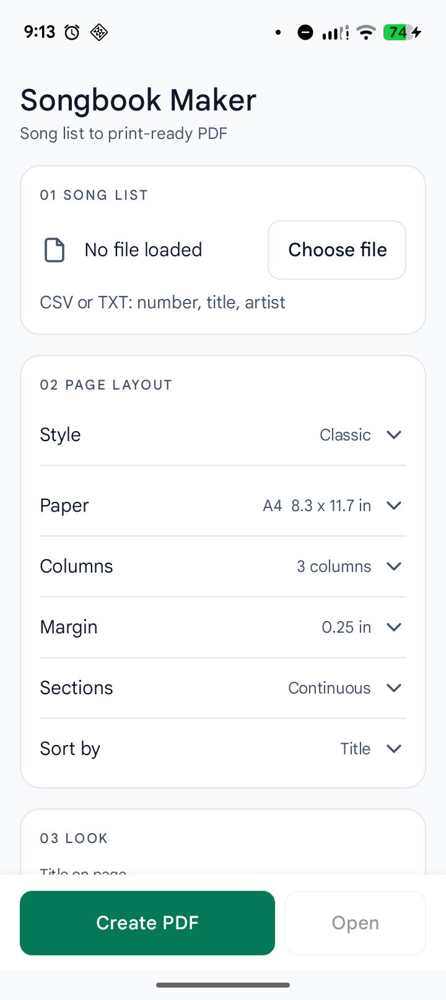
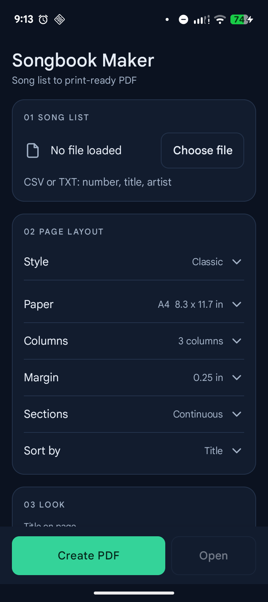

<div align="center">

# Songbook Maker

**Turn a karaoke song list into a print-ready PDF songbook.**

</div>

<p align="center">
  
  
</p>

Songbook Maker takes the song list you already keep - a plain text or CSV file with a
number, a title and an artist per line - and typesets it into a clean, numbered PDF
songbook, ready for the printer.

It comes in two shapes:

* a **command line tool** (Rust, no dependencies) for batch jobs and scripts
* an **Android app** (Kotlin, API 23+) for doing it right on the phone you hand to the
  singers

Both run the same Rust engine, so the PDF is identical whichever one you use. No
accounts, no ads, no network access: everything happens on your machine.

## What you get

* Paginated columns with alphabetic section letters and a `page / total` counter
* A4, Letter, Long and Legal paper, five margins, two to four columns
* Header and footer bands with your own texts, optional logo
* Text that shrinks to fit its cell instead of spilling into the next song
* Plain text in, PDF out - import errors are listed line by line

## Quick start

Command line:

```bash
cargo install --path cli
songbook songs.csv -o songbook.pdf --name "Karaoke Night"
```

Android:

```bash
cd android && ./build-native.sh && ./gradlew assembleDebug
adb install -r app/build/outputs/apk/debug/app-debug.apk
```

Pick a file, tap **Create PDF**, and the songbook lands in `Downloads/Songbook/`.

## Song list

```
10001,Bohemian Rhapsody,Queen
10002,Imagine,John Lennon
10003,Dancing Queen,ABBA
```

Commas, semicolons, pipes and tabs all work, quoted CSV is fine, and the number may
sit in any of the three columns - the order is detected for you.

## Documentation

| | |
|---|---|
| [docs/usage.md](docs/usage.md) | every option, the print geometry, building from source, tests |
| [docs/provenance.md](docs/provenance.md) | where the print layout comes from |
| [examples/](examples/) | sample song lists, a logo, a reference build |

## License

MIT - see [LICENSE](LICENSE).
