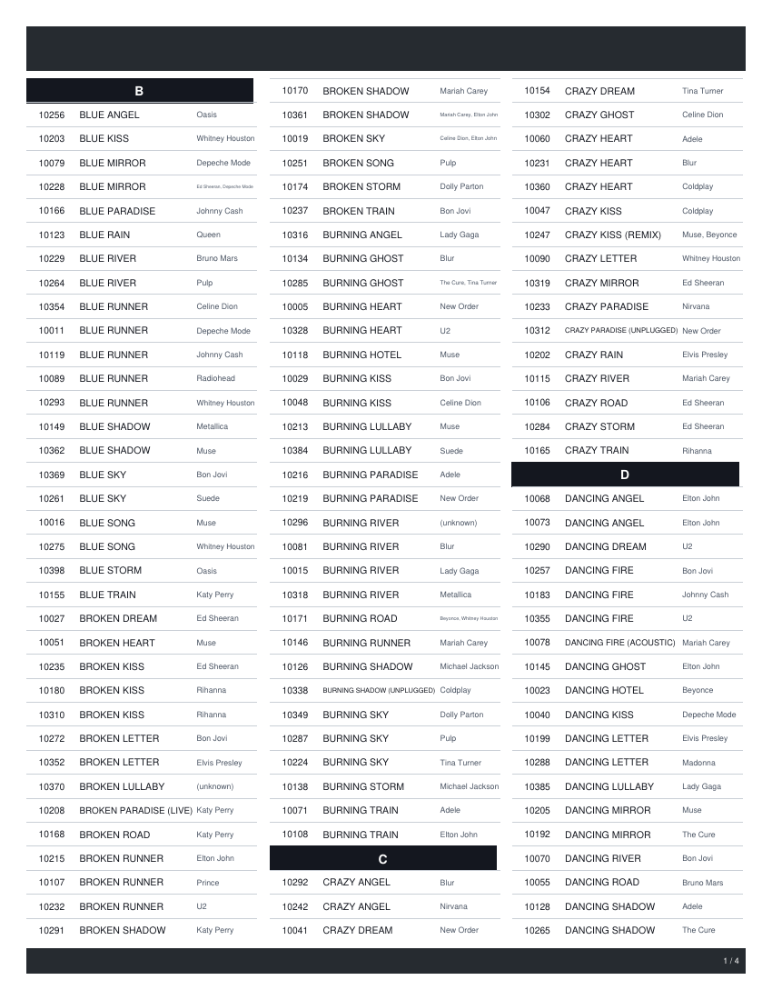
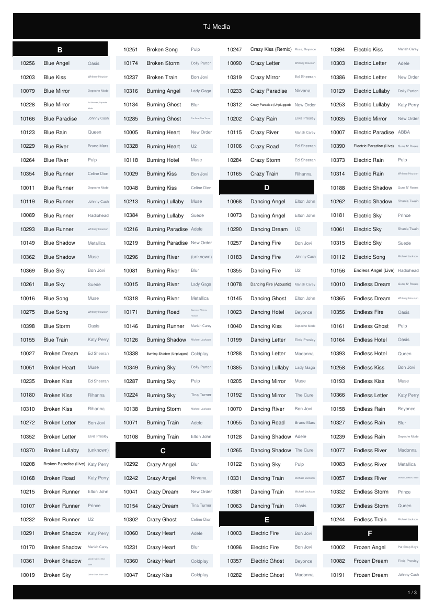

# Usage

Songbook Maker turns a song list into a PDF songbook. This page documents the command
line tool, the Android app, the layout engine and the build.

## Song list format

Any of these delimiters is detected from the file itself: `|`, TAB, `;`, `,`.
Quoted CSV fields are honoured for `,` and `;`.

| Columns | Layout |
|---|---|
| 3 | `number, title, artist` (also detected: `title, number, artist` and `artist, title, number`) |
| 6 | `number, title, artist, category, type, release` |

### Validation

| Problem | Reported as |
|---|---|
| fewer than 3 fields, empty number or title | `Invalid line` |
| title missing | `No title` |
| number not numeric | `Invalid number` |
| number already used | `Number exists` |
| sixth column is `user content` | silently skipped |
| artist empty | `(unknown)` |
| artist has `;` but no `,` | `;` becomes `,` |

Rejected lines are counted and printed with their line number; a bad line never aborts
the import. Numbers are parsed as floating point and truncated, so `1001.0` is valid
and equal to `1001`.

## Command line

```bash
songbook <INPUT> [OPTIONS]
```

| Option | Meaning |
|---|---|
| `-o, --output <FILE>` | output PDF (default: input name with `.pdf`) |
| `--paper <SIZE>` | `a4` (default), `letter`, `long`, `legal` |
| `--margin <INCH>` | `0.20`, `0.25` (default), `0.30`, `0.40`, `0.50` |
| `--columns <N>` | `2`, `3` (default), `4` |
| `--order <ORDER>` | `auto` (default), `nta`, `tna`, `atn` |
| `--sort <KEY>` | `title` (default), `artist`, `number` |
| `--sections <MODE>` | `continuous` (default), `newpage`, `none` |
| `--style <NAME>` | `default` (default), `platinum`, `tj` - see [styles](#styles) |
| `--borders <MODE>` | `all` (default), `rows`, `none` |
| `--zebra`, `--no-zebra` | tint every second row |
| `--uppercase` | print titles in upper case |
| `--zebra-color <HEX>` | zebra tint (default `F1F4F8`) |
| `--no-artist` | drop the artist column |
| `--name <TEXT>` | text in the middle of the top band |
| `--header-left`, `--header-right` | text in the top corners |
| `--header-center` | overrides `--name` |
| `--footer-center` | text in the middle of the bottom band |
| `--no-page-numbers` | hide the `n / total` counter |
| `--mirror` | swap header and footer sides on even pages |
| `--logo <PNG>` | logo drawn in the bottom band (119 x 20 pt) |
| `--bold` | bold song text |
| `--scale <F>` | divide every font size by this |
| `--num-size`, `--title-size`, `--artist-size`, `--letter-size`, `--header-size`, `--footer-size` | point sizes |
| `--page-color`, `--line-color`, `--band-color`, `--band-opacity`, `--num-color`, `--title-color`, `--artist-color` | colours, `RRGGBB` or `AARRGGBB` |
| `--quiet`, `-h`, `-V` | less output, help, version |

Examples:

```bash
songbook examples/songs.txt -o book.pdf --name "Karaoke Night" --header-left "Vol. 1"
songbook examples/songs.txt --paper letter --columns 2 --sections newpage --mirror
songbook examples/songs400.txt --logo examples/logo.png --footer-center "Songbook"
```

## Styles

Three looks ship with the engine. A style is applied before the other options, so
anything set explicitly wins - `--style tj --columns 3` keeps the TJ look on three
columns.

| Style | What it changes |
|---|---|
| `default` | full grid, light bands, black text on white |
| `platinum` | Letter paper, 3 columns, dark header and footer bands, hairline row rules, upper case titles, muted artist |
| `tj` | A4, 4 dense columns, no grid, zebra rows, black header band |

```bash
songbook songs.txt --style platinum -o platinum.pdf
songbook songs.txt --style tj --name "TJ Media" -o tj.pdf
```

<p>
  
  
</p>

Every part of a style is a normal option, so you can build your own from the table
above: `--borders none --zebra --zebra-color E8EEF7 --band-color 0A0A0A`.

## Android app

The app is a single screen: pick the file, set the layout, tap **Create PDF**.

It talks to the same engine through JNI, passing the options as `key=value` lines:

```
paper=a4
margin=0.25
columns=3
sections=continuous
sort=title
artist=1
bold=1
page_numbers=1
name=Karaoke Night
footer_center=Songbook
```

Keys: `paper`, `margin`, `columns`, `order`, `sort`, `sections`, `artist`,
`page_numbers`, `mirror`, `bold`, `scale`, `name`, `style`, `borders`, `zebra`,
`uppercase`, `zebra_color`, `header_left`, `header_right`,
`header_center`, `footer_center`, `band_opacity`, `num_size`, `title_size`,
`artist_size`, `letter_size`, `header_size`, `footer_size`, `page_color`,
`line_color`, `band_color`, `num_color`, `title_color`, `artist_color`.

**Where the PDF goes:** Android 10 and newer write it to
`Downloads/Songbook/<title>.pdf` through MediaStore, so any file manager or PDF viewer
can open it. *Open* launches a viewer, *Share* sends the same file. On older releases it
stays in the app cache and is served through a content provider.

## Print layout

All values are PDF points (72 per inch).

| Paper | Inches | Points |
|---|---|---|
| A4 | 8.3 x 11.7 | 597 x 842 |
| Letter | 8.5 x 11 | 612 x 792 |
| Long | 8.5 x 13 | 612 x 936 |
| Legal | 8.5 x 14 | 612 x 1008 |

Rows per page and the y of the first row are a fixed table per paper and margin:

| Paper | 0.20 | 0.25 | 0.30 | 0.40 | 0.50 |
|---|---|---|---|---|---|
| A4 | 39, 58 | 39, 58 | 39, 58 | 38, 68 | 37, 77 |
| Letter | 37, 52 | 36, 62 | 36, 62 | 35, 72 | 35, 71 |
| Long | 44, 57 | 44, 58 | 44, 58 | 43, 67 | 42, 77 |
| Legal | 48, 56 | 48, 56 | 47, 66 | 47, 65 | 46, 75 |

The grid:

```
rowHeight  = 19 pt
columnGap  = 8 pt
colWidth   = (pageW - 2*margin - (cols-1)*8) / cols
columnX[i] = margin + i*(colWidth + 8)
rest       = colWidth - 40
numberCol  = 40 pt   (42 if any number exceeds 9 999 999)
titleCol   = 0.65 * rest
artistCol  = 0.35 * rest
```

Rows fill column 1 top to bottom, then column 2, then the next page.

Font sizes start at 20 sp (title and number), 17 sp (artist) and 16 sp (section letter)
and shrink in 0.25 steps down to 9 sp. If the text still does not fit, it is split at
the last space or hyphen that fits and drawn on two lines; after that it is truncated
rather than overlapping the next cell. Numbers are centred in their box.

Decoration: 0.2 pt cell borders, a 35 pt top band and a 20 pt bottom band (black at
13 % by default), section letter boxes across the column, header baselines at
`margin + 17.5 + height/2` and the footer at `pageH - margin - 11 + height/2`.

Section letters: `continuous` draws the letter inside the flow, `newpage` starts a new
page per letter, `none` disables them. Rows are sorted case-insensitively.

## Building from source

### CLI

```bash
cargo install --path cli          # or: cd cli && cargo build --release
```

Rust 1.70 or newer, no dependencies.

### Android

Needs the Android SDK and NDK, `cargo-ndk` and the Android Rust targets:

```bash
rustup target add aarch64-linux-android armv7-linux-androideabi x86_64-linux-android
cargo install cargo-ndk

cd android
./build-native.sh                 # engine -> app/src/main/jniLibs
./gradlew assembleDebug
adb install -r app/build/outputs/apk/debug/app-debug.apk
```

`build-native.sh` cross-compiles the engine for arm64, armv7 and x86_64 and copies the
shared libraries into the app. The UI is plain Android views, no AndroidX and no
third-party libraries.

## Tests

```bash
cd cli && cargo test
```

The suite covers the parser, pagination, PDF primitives, the inflate implementation and
the JNI packet format. The app has no layout code of its own - it calls the same
`render_text()` - so these tests cover both front ends.

## Repository layout

```
cli/                  Rust engine and CLI
  src/lib.rs          options, render entry point, JNI packet format
  src/main.rs         command line front end
  src/import.rs       song list parser
  src/render.rs       print engine
  src/pdf.rs          PDF 1.4 writer, inflate, PNG decoding
  src/fonts.rs        Helvetica metrics
  src/android.rs      JNI entry points (feature "android")
android/              Kotlin app, plain views
  app/src/main/java/io/github/codeghost/songbook/
    MainActivity.kt   UI, file picker, options, saving
    Engine.kt         JNI wrapper and packet decoding
    PdfProvider.kt    content provider for opening and sharing
  build-native.sh     cargo ndk -> app/src/main/jniLibs
examples/             sample lists, logo, reference build
docs/                 this page, provenance, screenshots
```
